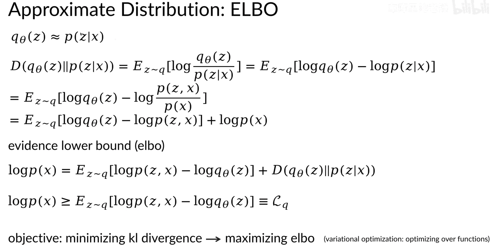
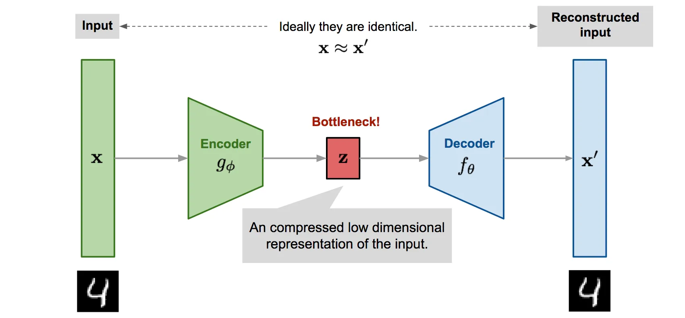
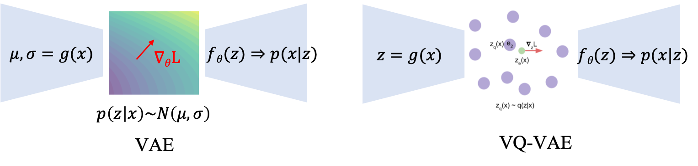
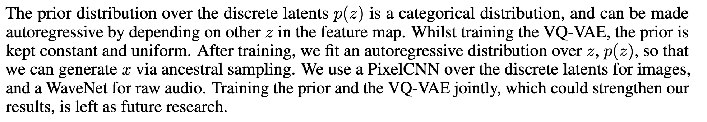
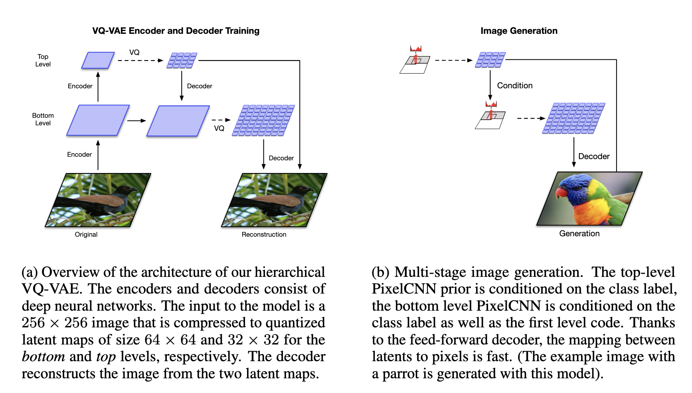
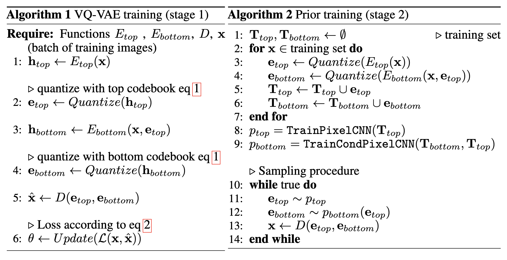

[Material Source](https://www.bilibili.com/video/BV1Gs4y157BU/)
## Pre-requisite

### Latent Graph Model
**Latent variable:** Variables that can only be inferred indirectly through a mathematical model from other observable variables that can be directly observed or measured. For example, when we have a photo (of cat), each pixel value is an observable variable, while "cat" is a latent variable indicating the category. **Latent variable can be interpreted as properties of observable variables.**

### Variational Inference
The process of INFERENCE refers to **inferring latent variables from observed data**. Formally, we have $x\sim p(x)$ which is observable, and we want to know the distribution of $z\sim p(z|x)$, which is the posterior distribution of $z$. 

According to the Bayes Theory, we have $$p(z|x)=\frac{p(x|z)p(z)}{p(x)}=\frac{p(x|z)p(z)}{\int_z p(x,z)dz}$$ Howerver, although $x$ can be sampled from $p(x)$, the distribution of all $x$ is impossible to explicitly model. We have to model the joint distribution $p(x,z)$ instead.

This difficulty motivates the idea of variational inference: the process of using easier distribution to approximate the complicated distribution $p(z|x)$. 
> Sample $z$ from distribution $p(z)$ to get $x\sim p(x|z)$ is the process of generation.

### ELBO
In modern practice, we often use a prior distributon (normal distribution) $q_\theta(z)\approx p(z|x)$ to approximate $p(z|x)$. The surveillance of this optimization is the $KL\ Divergence(q_\theta(z)||p(z|x))$.

We can have above equitions easily. Specially, the term $p(x)$ is irrelevant to $\theta$, so it is determined in latent space, in other word, determined after the NN. We can subsequently have equition in the second last line. Note that the KL divergence is greater than 0 unless $q_\theta(z) = p(z|x)$. 

Because $p(x)$ is determined, minimizing the KL divergence is equivalent to maximize the expectation term, which is called **the lower bound of evidence**.

The evidence lower bound can be further formulated as:
$$L_\theta(x)=E_{z\sim q_\theta(z)}[log\frac{p(z,x)}{q_\theta(z)}]=E_{z\sim q_\theta(z)}[log\frac{p(x|z)p(z)}{q_\theta(z)}]$$

$$=E_{z\sim q_\theta(z)}[log{p(x|z)}]-D(q_\theta(z)||p(z))$$

## VAE
### Intuition
Features can be compressed into attributes (latent variables), and a probablistic distribution can be used to model the variation of this attribute. For example, for a series of facial photos, the extent of a facial expression (from crying to laughing) can be controlled by a normal distribution.

Once the latent distribution is well-defined, we can sample attributes from this distribution to generate (reconstruct) different images.

### Structure

In VAE, $z$ is the latent variable. We havs $p(z|x)$ decided by $g_\Phi(x)$, where $g_\Phi(\cdot)$ is the encoder of VAE, and a prior distribution $q_\theta(z)\sim N(\mu,\sigma)$. The generation (decoding) process can be formulated as $x'=f_\theta(z)\sim p(x|z)$. We assume $q_\theta(z|x)=N(z;\mu_\Phi(x),\sigma_\Phi(x)^2I)$， $p(z)\sim N(z;0,I)$, and $x\sim N(x;f(z),\epsilon I)$. The object function now is $$L_\theta(x)=-\frac12 E_\theta(z)[\|| x-f_\theta(z)\||_2^2]-\frac12 (N\sigma _\Phi(x)^2+\||\mu _\Phi(x)\||^2_2-2Nlog\sigma _\Phi(x))+Const$$.

In short, we want to esitmate latent variable $z$ given $x$ as precise as possible, so we have to maximize ELBO. We constrain the true distribution of $z$ $p(z)$ to be simple, as $N(z;0,I)$, and constrain the estimation distribution to be simple, as $N(\mu,\sigma)$, where $\mu$ and $\sigma$ is predicted by the encoder $g_\Phi(\cdot)$. However, we still have a term $p(x|z)$, which follows $N(z;f(x),I)$, where $f(\cdot)$ is the decoder.

### Reparameterization trick
The process of generating $z$ given $\mu,\sigma$ is not differentiable, so there is a Reparameterization trick to have $z=\mu + \sigma \epsilon$, where $\epsilon\sim N(0,I)$. Mutiplication is now differentiable.

## VQ-VAE
[**Vector Quantization VAE**](https://arxiv.org/abs/1711.00937)

Prior distributio $p(z)$ is continuous Gaussian distribution in original VAE, however, in VQ-VAE, $p(z)$ is discrete. Various learnable vectors form a codebook (or the basis of the feature space), and what the encoder predicted is the indecies of the codes in the codebook to form $z$, namely $q_\theta(z)$, which is an one-hot vector. $p(z)=\frac1K$ is the initialized index with equal probability. The overall goal of is to use the predicted index to find vectors in the codebook that mimic the real distribution as well as possible.

For optimizing ELBO, as $q_\theta(z)$ follows one-hot distribution, $D(q_\theta(z)||p(z))$ is consistently $logK$. Only the first term, minimizing $L_{reconstruction}=E_{z\sim q_\theta(z)}[log{p(x|z)}]$ is left. Note that the gradients of decoder is directly copied to the encoder, which means no gradient passes to the embeddings in the codebook. Thus, the codebook is proposed to be learned from encoder, as $$L_{embedding}=||sg[z_e(x)]-e||^2_2+\beta ||z_e(x)-sg[e]||^2_2\ ,\ \text{where} sg \text{ is stop gradient},$$
> The first part of $L_{embedding}$ is codebook loss to optimize embeddings.
> The second part of $L_{embedding}$ is commitment loss encourage the output of encoder to stay close to the chosen codebook vector to prevent it from flucturating too frequently from one code vector to another.

The overall optimization target is $$L=E_{z\sim q_\theta(z)}[log{p(x|z)}]+||sg[z_e(x)]-e||^2_2+\beta ||z_e(x)-sg[e]||^2_2.$$ The decoder optimises the first loss term only, the encoder optimises the first and the last loss terms, and the embeddings are optimised by the middle loss term. 

### Generation

The generation process of VQ-VAE requires a PixelCNN to auto-regressively predict the next index. During training, prior $p(z)$ is a uniform distribution. But during generation, the index is random sampled first then predicted, without the help of the encoder.

## VQ-VAE-2
[paper](https://arxiv.org/abs/1906.00446)

Multi-level (2 levels) features are considered in VQ-VAE 2. Higher level features are learned, because there are less information to quantize. Then, the learned codebook is considered as a condition for learning lower level features. The prior sampling model is trained on two levels too.