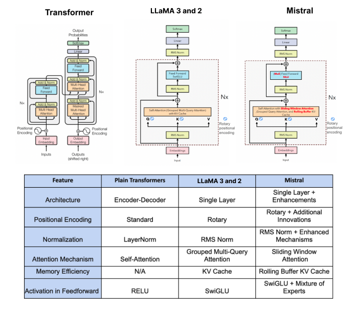
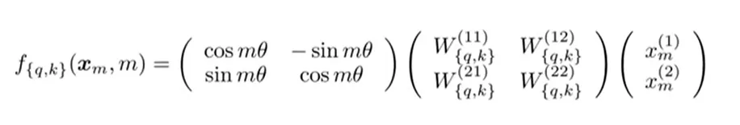
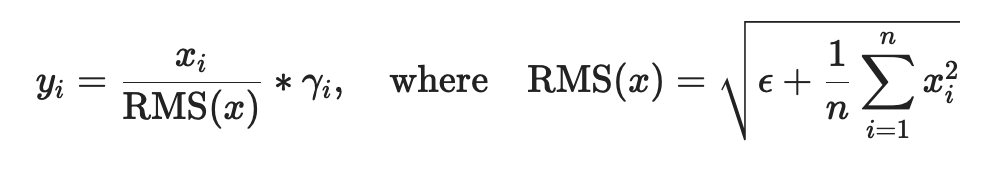

## Llama2 / 3
### Structure


#### Rotary Position Embedding
There are primarily two methods to generate absolute position embeddings:
1. **Learnable.** Limited by maximum sequence length.
2. **Sinusoidal Functions.** This method involves constructing unique embeddings for each position using a sinusoidal function. Although the intricate details of this construction are complex, it essentially provides a unique positional embedding for every position in a sequence.
Empirical studies have shown that learning from data and using sinusoidal functions offer comparable performance in real-world models.

Absolute position embeddings is **limited by sequence length** and **embeddings are independent of each other**. This means that in the model’s view, the difference between positions 1 and 2 is the same as between positions 2 and 500. However, intuitively, positions 1 and 2 should be more closely related than position 500, which is significantly farther away. This lack of relative positioning can hinder the model’s ability to understand the nuances of language structure.

RoPE takes absolute position and relative distance into consideration. The equation in matrix form is:

$$
\mathbf{x} = \mathbf{W} \mathbf{x} e^{i n \theta} = \mathbf{W} \mathbf{x} (\cos n \theta + i \sin n \theta)
$$
In other words, 
Consequently, the relative position distance is included in the inner production.

```python
import torch
import torch.nn as nn

class RotaryPositionalEmbedding(nn.Module):
    def __init__(self, d_model, max_seq_len):
        super(RotaryPositionalEmbedding, self).__init__()

        # Create a rotation matrix.
        self.rotation_matrix = torch.zeros(d_model, d_model, device=torch.device("cuda"))
        for i in range(d_model):
            for j in range(d_model):
                self.rotation_matrix[i, j] = torch.cos(i * j * 0.01)

        # Create a positional embedding matrix.
        self.positional_embedding = torch.zeros(max_seq_len, d_model, device=torch.device("cuda"))
        for i in range(max_seq_len):
            for j in range(d_model):
                self.positional_embedding[i, j] = torch.cos(i * j * 0.01)

    def forward(self, x):
        """
        Args:
            x: A tensor of shape (batch_size, seq_len, d_model).
        Returns:
            A tensor of shape (batch_size, seq_len, d_model).
        """
        # Add the positional embedding to the input tensor.
        x += self.positional_embedding
        # Apply the rotation matrix to the input tensor.
        x = torch.matmul(x, self.rotation_matrix)
        return x
```

#### RMSNorm
RMSNorm is applied to the input $x$ before and after (before MLP) self-attention. Pytorch implementation is [here](https://pytorch.org/docs/stable/generated/torch.nn.modules.normalization.RMSNorm.html). 

It only scales x rather than calculating the mean and std of $x$, as done in previous norm methods.

```python
class LlamaRMSNorm(nn.Module):
    def __init__(self, hidden_size, eps=1e-6):
        """
        LlamaRMSNorm is equivalent to T5LayerNorm
        """
        super().__init__()
        self.weight = nn.Parameter(torch.ones(hidden_size))
        self.variance_epsilon = eps

    def forward(self, hidden_states):
        input_dtype = hidden_states.dtype
        hidden_states = hidden_states.to(torch.float32)
        variance = hidden_states.pow(2).mean(-1, keepdim=True)
        hidden_states = hidden_states * torch.rsqrt(variance + self.variance_epsilon)
        return self.weight * hidden_states.to(input_dtype)
```
#### SwiGELU
$$\text{SwiGLU}\left(x, W, V, b, c, \beta\right) = \text{Swish}_{\beta}\left(xW + b\right) \otimes \left(xV + c\right)$$
Only applied to MLP layers.
```python
class LlamaMLP(nn.Module):
    def __init__(self, config):
        super().__init__()
        self.config = config
        self.hidden_size = config.hidden_size
        self.intermediate_size = config.intermediate_size
        self.gate_proj = nn.Linear(self.hidden_size, self.intermediate_size, bias=config.mlp_bias)
        self.up_proj = nn.Linear(self.hidden_size, self.intermediate_size, bias=config.mlp_bias)
        self.down_proj = nn.Linear(self.intermediate_size, self.hidden_size, bias=config.mlp_bias)
        self.act_fn = ACT2FN[config.hidden_act]

    def forward(self, x):
        down_proj = self.down_proj(self.act_fn(self.gate_proj(x)) * self.up_proj(x))
        return down_proj
```