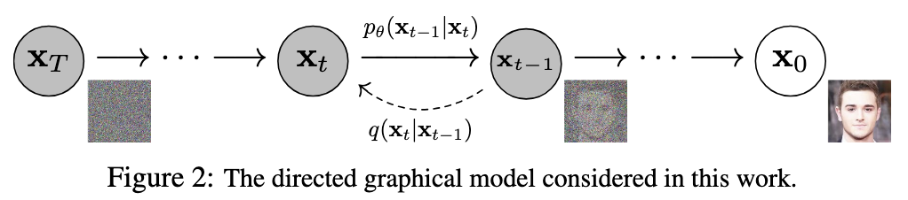
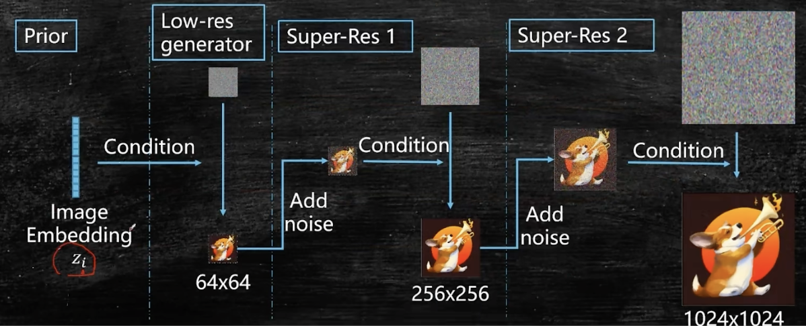
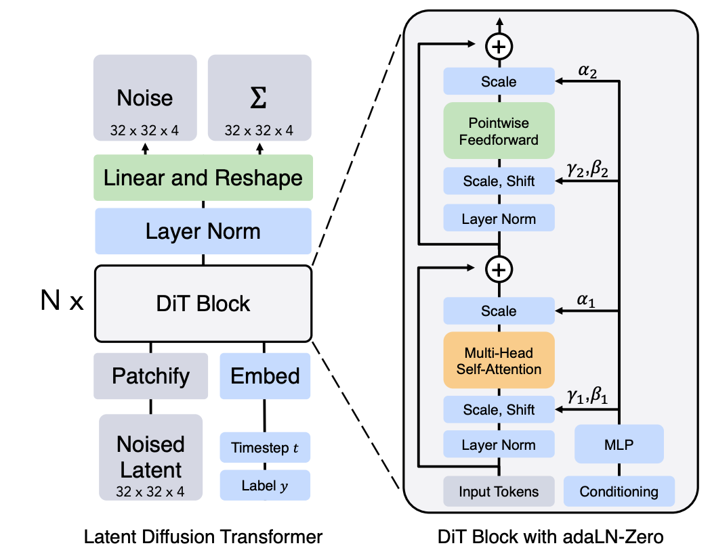

> [Material Source](https://www.bilibili.com/video/BV13J4m1K73z/). Thanks for the open-source lecture!

Before Diffusion, the generation models are mostly based on autoregressive methods like VQ-VAE2. Diffusion has made below changes:
- Autoregressive Prior -> Diffusion Prior
- VAE-like Decoder -> Diffusion Decoder

## Basic Diffusion Model

Diffusion is built on Markovian Hierarchical VAE, that each latent is from the last latent. There are three constrains for diffusion model:
1. All the data sample $x$ and latent at time $t$ ($z_t$) have same channels.
2. Encoder $f(z_t|z_{t-1})$ doea not need learning. It is determistric that $z_t\sim N(\mu_{z_{t-1}},1)$.
3. Last latent $z_T\sim N(0,1)$.

We only have to learn a decoder to restore the image from a standard gaussian distribution. Each decoder $Dec_t(\cdot)$ predicts the mean value of $x_{t-1}$ the previous time step $\mu_{t-1}$.

## DDPM

The prediction of $x_{t-1}$ is changed to predicting the mean value of the noise at $t$, so that $x_t-noise_{t}\rarr x_{t-1}$. This helps training because the noise is restritced to gaussian distribution, and the searching space for the decoder model is much smaller.
> Moreover, there is also an optimization for the loss function.

Given $\epsilon\sim N(0,1)$, the prediction process is shown in $\epsilon_\theta\left(\sqrt{\bar{\alpha}_t}x_0 + \sqrt{1 - \bar{\alpha}_t}\epsilon,\ t\right)$. 

After predicting the noise for current step, as shown in stage2, we can sample the previous $x_{t-1}$ according to the noise. $\sigma _t z$ is a term to ensure diversity, where $z\sim N(0,1)$. 

The whole process for denoising in one step can be written as: $n_t=f_\theta (x_t,\ t)$.

## Diffusions Beat GANs
This work optimizes the structural design of the decoder (based on U-Net + attention layer), including depth heads, attn resolutions. 

More importantly, this work proposes classifier guidance. Incorporating guidance by cross-attention based mechanism can be ineffective because there is a shortcut (making the weights in attention zero). This work ensures the direction for sampling $\mu$ is toward a given class $y$ by incorporating a classifer for each $x_t$, with a $s$ serving as a hyper-parameter for balance.

## GLIDE: Classifier-free Guidance
For classifier guidance, the classifiers need to be trained from scratch each time because it is not possible to load a pre-trained classifier which has never seen noisy pictures.

Classifier-free Guidance (CFG) uses this strategy: during training, there are samples trained both with (90\%) and without text (10\%) during adding noise & denoise stages, so the model learns how to predict the corresponding $x_t$ give $t$ with text condition.

During sampling, $x_t$ is $$\hat{\epsilon}_\theta(x_t|x_{t+1},y)=\epsilon_\theta(x_t|x_{t+1},\Phi)+s(\epsilon_\theta(x_t|x_{t+1},y)-\epsilon_\theta(x_t|x_{t+1},\Phi))$$, a weighted sum of generation results with/without text condition. The direction choice is controlled by hyper-parameter $s$. 

In this way, the classifier is omitted, while the influence of text can be included during both training and sampling stages. This design can facilitate the balance between fidelity and diveristy.

However, this method requires double inference (with/without text condition). Moreover, with a large $s$, the diversity of generated image would decrease because the image feature space tends to be smaller.

## DALL$\cdot$E 2 (unCLIP)

Overall design: generate image based on the image embeddings of CLIP and text prior. The model aligns text and visual embedding at first, then the text embedding is input to a prior network to predict the image embedding. The predicte image embedding works as the condition for decoding.

There are two choices for the prior network. Comparison between Auto-Regressive Model and Diffusion Model as a prior:
- AR: given text embedding, predict the next image embedding one by one.
- Diffusion: using a transformer model to predict unknown and noise-free image (not the noise). The training target is $$L\=E_{z_0​,ϵ,t}​\[∥ϵ−ϵ_θ​(z_t​,t∣\text{text})∥^2\]$$
  
The decoder design is shown below. It uses the image embedding as the initial condition, then does conditional super-resolution gradually.

Benefits of using an image embedding: 

1. Variation: The generated image follows the same structure and position as the original image (instead of using a random noise in each step); 
2. Interpolation: using the image embedding gained from two images to ensure the consistency between original images and generated images.
3. Text Diffs: Because the image features are aligned with text features, the difference between original and target text features can represent the difference between original and target image features.

CFG: The text prior is necessary. OpenAI team compares using pure text (without CLIP), using CLIP text embedding as the condition, and using text prior to generate image embedding as the condition, eventually chooses the last one.

However, the text-matching accuracy of generated image is still low. The generated image can lack of details. It is also hard to directly generate text in images. It is also hard to generate images that are conflicting with reality.

## Imagen

The decoder structure of Imagen is similar to DALLE 2, with low resolution image **added noise** as the conditon for super-resolution. However, there is no prior network. The text encoder is replaced by a frozen text encoder (T5) to generate text embeddings, added to the sampling model as condition by cross-attention. They also prove that T5 is more effective than CLIP text encoder. There're other techniques such as dynamic thresholding and efficient U-Net.

> This work has also proven that increasing the text model's scale is more effective than increasing the scale of denoise model.

## Stable Diffusion (LDM)

Motivation: previous works require multi-level decoding, which is not computationally friendly. Stable Diffusion moves their attention onto latent space of VAE, diffusing and denoising on latent space. 

Additionally, various condition types are allowed by training different encoders.

### SDXL

This model uses two text encoders and the extracted embeddings are concatenated together. It uses a Base and a Refiner connected together as a decoder, in which the output of Base decoder is the input of the Refiner decoder (same resolution).

It adds the resolution of the image as the condition. Because during augmentation for training, some images are upsampled and some are downsampled. With explicit resolution information, some confusion can be avoided to improve generation quality. It is also possible to generate image with different resolution. To avoid the confusion caused by crop operation, the coordinate of the left-top point is input to the model at the same time.

The problem of this model includes: hard to generate complex scenarios, concept bleeding, fidelity...

### SDXL-Turbo
Includes distillation and adversial techniques to improve training efficiency (reduce sampling steps).

## DiT

It replaces the U-Nets by Transformers, proving the scalability of transformers. The scale is controlled by the condition (encoded by MLP).

## SD3: Multi-modal DiTs

Motivation: text and image are the same important.
- Input: text enbedded by different text encoders + noisy latent;
- MM-DiT block: image and text go through different structure, fused by cross-attention

## Summary
