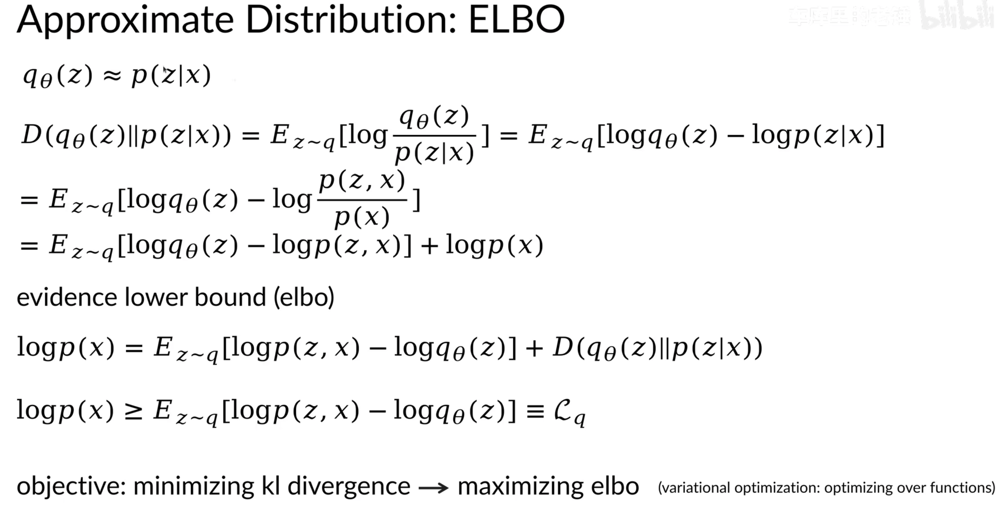

[Material Source](https://www.bilibili.com/video/BV1Gs4y157BU/)
## Pre-requisite

### Latent Graph Model
**Latent variable:** Variables that can only be inferred indirectly through a mathematical model from other observable variables that can be directly observed or measured. For example, when we have a photo (of cat), each pixel value is an observable variable, while "cat" is a latent variable indicating the category. **Latent variable can be interpreted as properties of observable variables.**

### Variational Inference
The process of INFERENCE refers to **inferring latent variables from observed data**. Formally, we have $x\sim p(x)$ which is observable, and we want to know the distribution of $z\sim p(z|x)$, which is the posterior distribution of $z$. 

According to the Bayes Theory, we have $$p(z|x)=\frac{p(x|z)p(z)}{p(x)}=\frac{p(x|z)p(z)}{\int_z p(x,z)dz}$$ Howerver, although $x$ can be sampled from $p(x)$, the distribution of all $x$ is impossible to explicitly model. We have to model the joint distribution $p(x,z)$ instead.

This difficulty motivates the idea of variational inference: the process of using easier distribution to approximate the complicated distribution $p(z|x)$. 
> Sample $z$ from distribution $p(z)$ to get $x\sim p(x|z)$ is the process of generation.

### ELBO
In modern practice, we often use a NN formed $q_\theta(z)\approx p(z|x)$ to approximate $p(z|x)$. The surveillance of this optimization is the $KL\ Divergence(q_\theta(z)||p(z|x))$.

We can have above equitions easily. Specially, the term $p(x)$ is irrelevant to $\theta$, so it is determined in latent space, in other word, determined after the NN. We can subsequently have equition in the second last line. Note that the KL divergence is greater than 0 unless $q_\theta(z) = p(z|x)$. 

Because $p(x)$ is determined, minimizing the KL divergence is equivalent to maximize the expectation term, which is called the lower bound of evidence.

## VAE
### Intuition
Features can be compressed into attributes (latent variables), and a probablistic distribution can be used to model the variation of this attribute. For example, for a series of facial photos, the extent of a facial expression (from crying to laughing) can be controlled by a normal distribution.

Once the latent distribution is well-defined, we can sample attributes from this distribution to generate (reconstruct) different images.