## Camera model
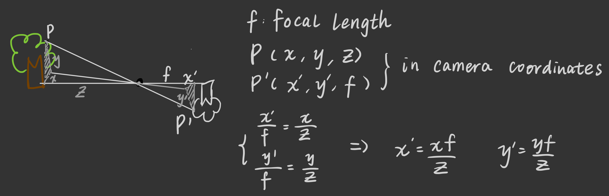

### Rigid Transforms
- **Rotation** matrices are square, orthogonal matrices with determinant one. Due to the convention of matrix multiplication, the rotation achieved by first rotating around the z-axis, then y-axis, then x-axis is given by the matrix product $R_xR_yR_z$.
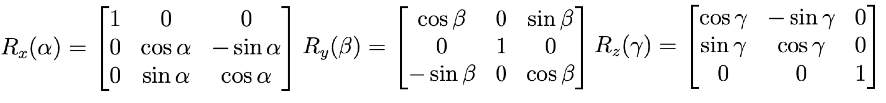
- **Translations**: $P'=P+t=TP$
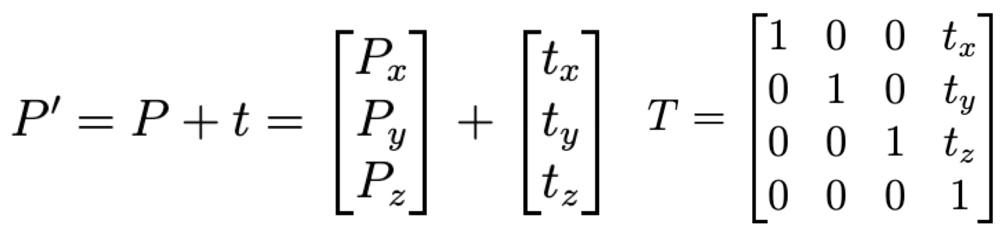
- **Scale**: $S=Diag(S_1,S_2,S_3)$
 
All together, the transformation matrix can be written as: 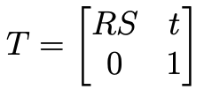 Projective transformations occur when the final row of T is not $[0\ 0\ 0\ 1]$.

Transformations:
- **Isometric transformation**: preserve distances, $R$ & $T$;
- **Similarity transformation**: preserve shape, isometric transformation & $S$; 
- **Affine transformations** are transformations that preserve points, straight lines, and parallelism.
- **Projective transformations** or **homographies**: maps lines to lines, but does not necessarily preserve parallelism. It preserves collinearity of points. Cross ratio of four collinear points remains invariant under projective transformations. 
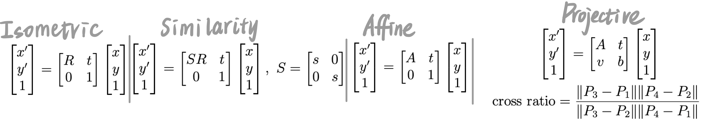

### Lenses
The conflict between crispness and brightness exists, which can be mitigated by using lenses. If we replace the pinhole with a lens that is both properly placed and sized, then it satisfies the following property: all rays of light that are emitted by some point P are refracted by the lens such that they converge to a single point P′ in the image plane.

#### Properties
Lenses have an effective range at which cameras can take clear photos, which is known as **depth**. Camera lenses focus all light rays traveling parallel to the optical axis to one point known as the **focal point**. The distance between the focal point and the center of the lens is commonly referred to as the **focal length $f$**. Furthermore, light rays passing through the center of the lens are not deviated. We thus can arrive at a similar construction to the pinhole model to get the coordinates of a point P' in the image plane.

#### Distortion
In lens-based model, $z′ = f +z_0$ with a derivation term $z_0$. Since this derivation takes advantage of the paraxial or “thin lens” assumption ($sin(\theta)=\theta$), it is called the paraxial refraction model.

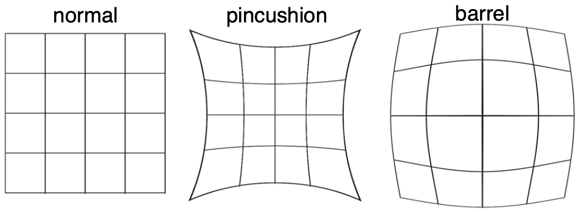
A number of aberrations can occur: 
> Radial distortion, which causes the image magnification to decrease **(barrel distortion)** or increase **(pincushion distortion)** as a function of the distance to the optical axis.

## Projective Transformation
$$P\rightarrow P':\ \mathbb{R}^3\rightarrow\mathbb{R}^2$$

### Camera Matrix Model & Intrinsic Parameters
The image plane has its origin at where camera's $z$ axis intersects with the image plane, while digital image coordinates typically have their ori- gin at the lower-left corner of the image. Thus, a translation vector $[c_x,\ c_y]^T$ can be applied to project actual P into P' in digital image coordinates as: $$P'=[x',\ y']^T=[\frac{xf}{z}+c_x,\ \frac{yf}{z}+c_y]^T $$

At the same time, the points in digital images are expressed in pixels, while points in image plane are represented in physical measurements (e.g. centimeters). Two new parameters $k$ and $l$, whose unit is something like pixel/cm, are introduced for unit translation. If $k = l$, the camera has **square pixels**. Now, the mapping is:$$P'=[x',\ y']^T=[\frac{xfk}{z}+c_x,\ \frac{yfl}{z}+c_y]^T=[\alpha\frac{x}{z}+c_x,\ \beta\frac{y}{z}+c_y]^T$$

Now we expand $P'=(x',y')$ to $P'=(x',y',1)$ to allow above transformation to be written in matrix multiplication form. The final coordinate has to be 1, so $(v_1,v_2,...,v_n,w)$ has to be written in $(\frac{v_1}w,\frac{v_2}w,...,\frac{v_n}w)$. Now, we have:
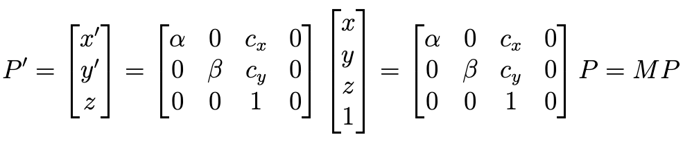 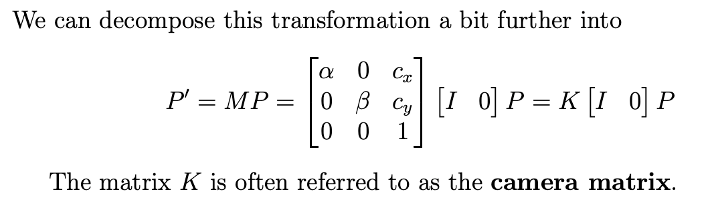

With skewness and distrotion considered, the matrix can be extended as: 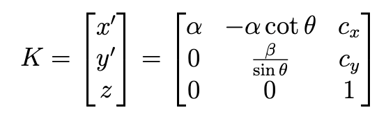
Overall, camera matrix K has 5 degrees of freedom: 2 for focal length, 2 for offset, and 1 for skewness. These parameters are collectively known as the **intrinsic parameters**.

### Extrinsic Parameters
It relates points from the world reference system to the camera reference system. This transformation is captured by a rotation matrix $R$ and translation vector $T$. Given a point in a world reference system $P_w$: 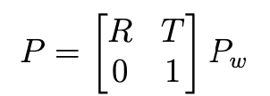 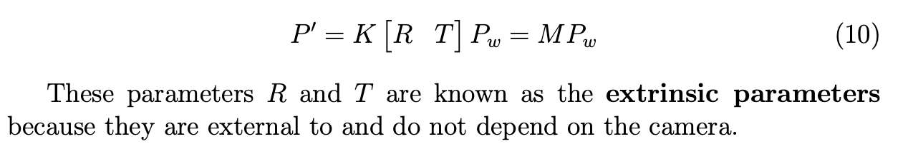

### Calibration
We do this by solving for the intrinsic camera matrix $K$ and the extrinsic parameters $R$, $T$. We use rig with known pattern to sample reference points, and establish equations like $$p_i=[u_i,\ v_i]^T=MP_i=[\frac{m_1P_i}{m_3P_i},\ \frac{m_2P_i}{m_3P_i}]^T$$ to solve, where $m_1,\ m_2,\ m_3$ is the rows of $M$. There are 11 unknown paramters in $M$, so we must sample at least 6 points in a rig. The equation is: 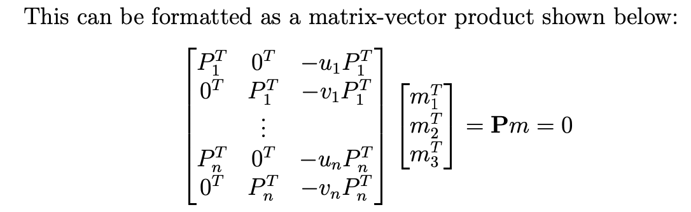

## Single image to 3D view

### Points and Lines
A line is defined as: $$\forall p=[x,\ y]^T\in l,\ [a\ b\ c\ ]\cdot [x\ y\ 1]^T=0$$
In general, two lines $l$ and $l′$ will intersect at a point $x$. This point is defined as the **cross product** between $l$ and $l′$. The point of intersection at infinity of two parallel lines is called an **ideal point** $p_\infty=[1\ 1\ 0]^T$ whose last term in homogeneous coordinate system is 0. **Lines at infinity** is the line of $l_\infty=[0\ 0\ 1]^T$.

A projective transformation generally maps points at infinity to points that are no longer at infinity (Left). However, this is not the case for affine transformations, which map points at infinity to points at infinity (Right).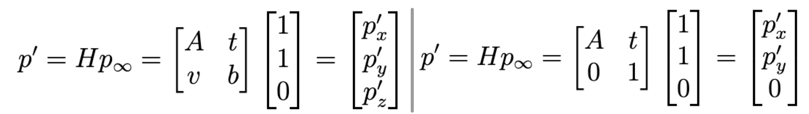

Given point $x$ and a line $l$, projective transformation $H$ transforms the point to $x'=Hx$ and $l'=H^{-T}l$. 

Similarly, the projective transformation of a line at infinity does not necessarily map to another line at infinity; affine transformations still map lines at infinity to lines at infinity.

### Vanishing points and lines
A plane is defined as: give a normal vector $(a\ b\ c)$ and $d$ for the distance from the origin to the plane, all points $x$ that satisfies $x^T\cdot [a\ b\ c\ d]^T=0$. Lines in 3D are defined as the intersection of two planes.  Points at infinity in 3D are again defined as the intersection point of parallel lines in 3D. 

If we apply a projective transformation to one of these points at infinity $x_∞$, then we obtain a point $p_∞$ in the image plane, which is no longer at infinity in homogeneous coordinates, which is known as a **vanishing point**.

Let us define $d = (a, b, c)$ as the direction of a set of 3D parallel lines in the camera reference system. These lines intersect to a $p_\infty$ and the projection of such a point in the image returns the vanishing point $v$ in image plane: $$v=Kd,$$ where $K$ is the intrinsic matrix of the camera. The direction $d$ can be given as $$d=\frac{K^{-1}v}{\Vert K^{-1}v\Vert}$$

A line at infinity $l_\infty$ is defined as the line where two parallel planes intersect. The projective transformation of $l_∞$ to the image plane is called the vanishing line or the horizon line $l_{horiz}$: $$l_{horiz}=H_P^{-T}l_\infty$$
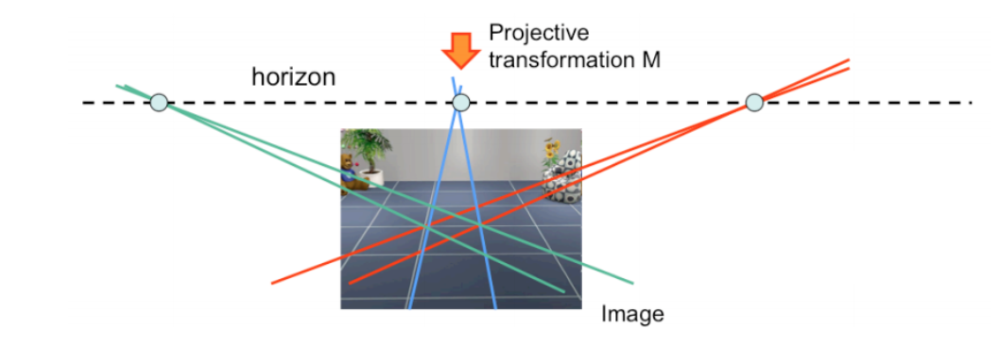
In other words, if we can recognize the horizon line associated with a plane, and if our camera is calibrated, then we can estimate the orientation of that plan. The normal vector $n$ is calculated as $n=K^Tl_{horiz}$.

Suppose that two pairs of parallel lines in 3D have directions $d_1$ and $d_2$, and are associated with the points at infinity $x_{1,∞}$ and $x_{2,∞}$. Let $v_1$ and $v_2$ be the corresponding vanishing points. Then, we find that the angle θ between $d_1$ and $d_2$ is given by 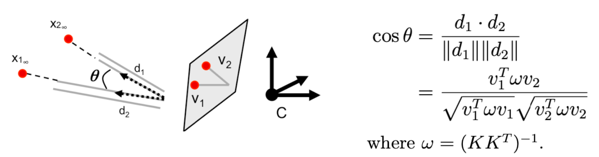

> Given 3 vanishing points of 3 sets of perpendicular lines, we can esitimate the intrinsic matrix $K$.