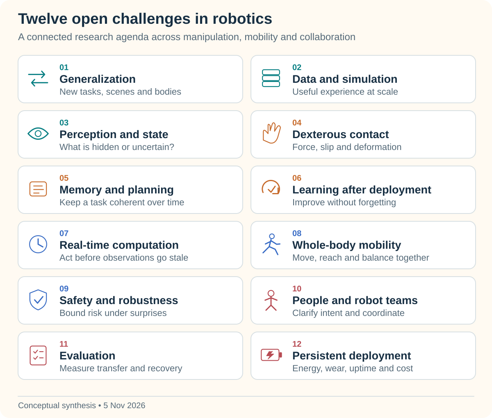
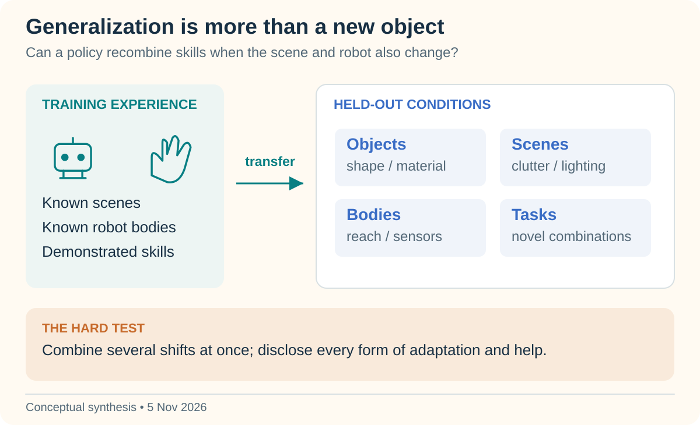
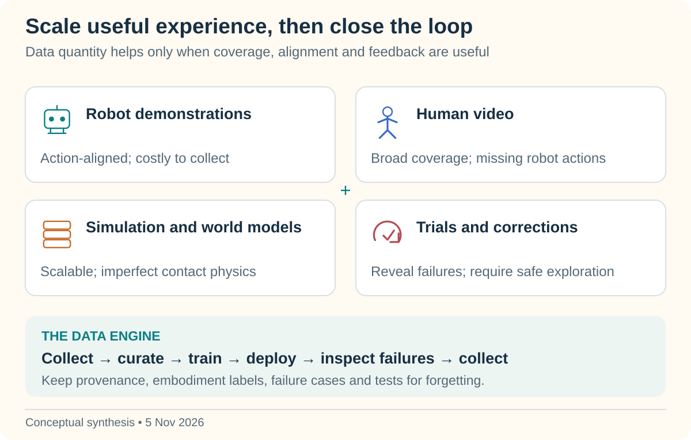
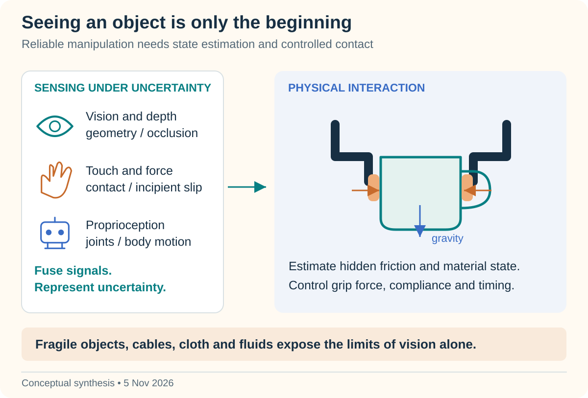
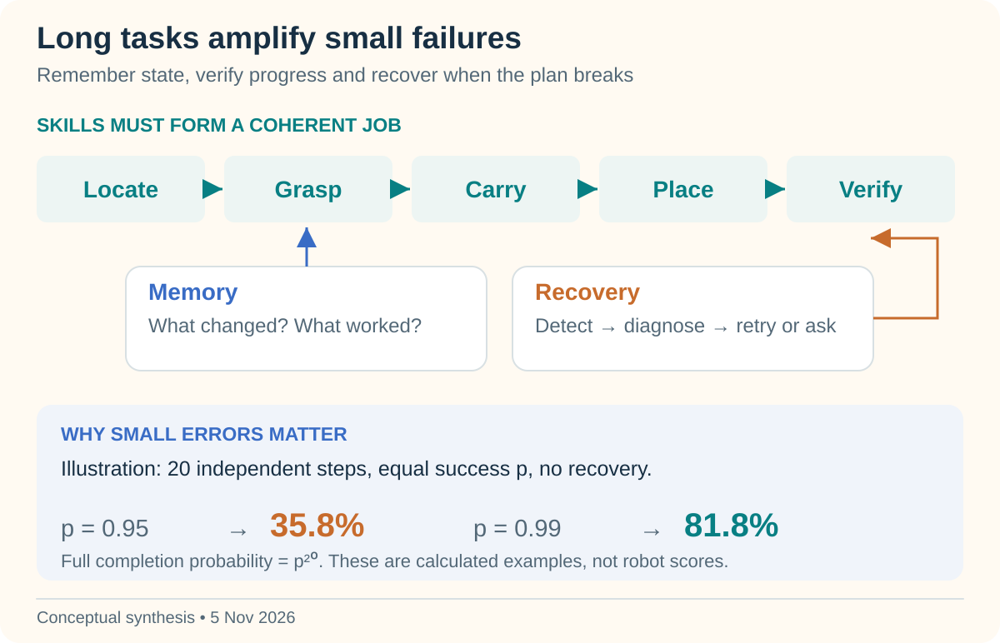
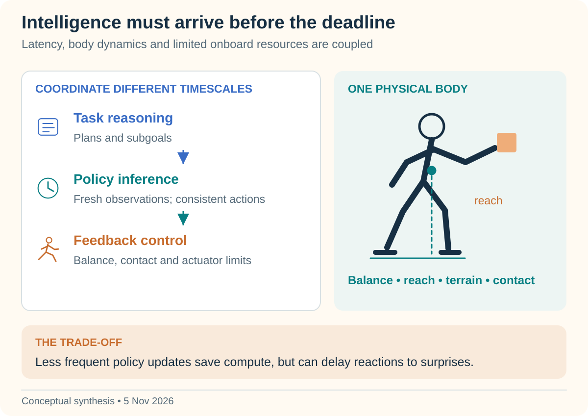
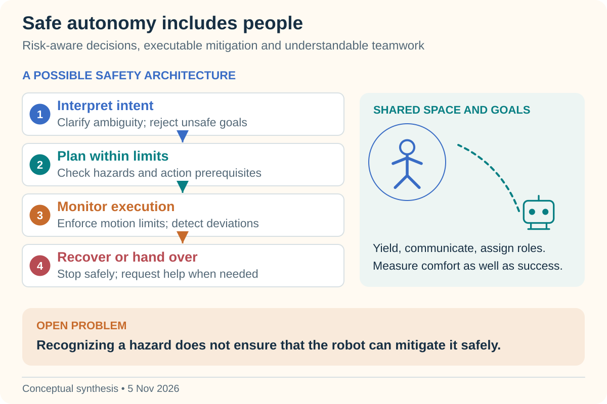
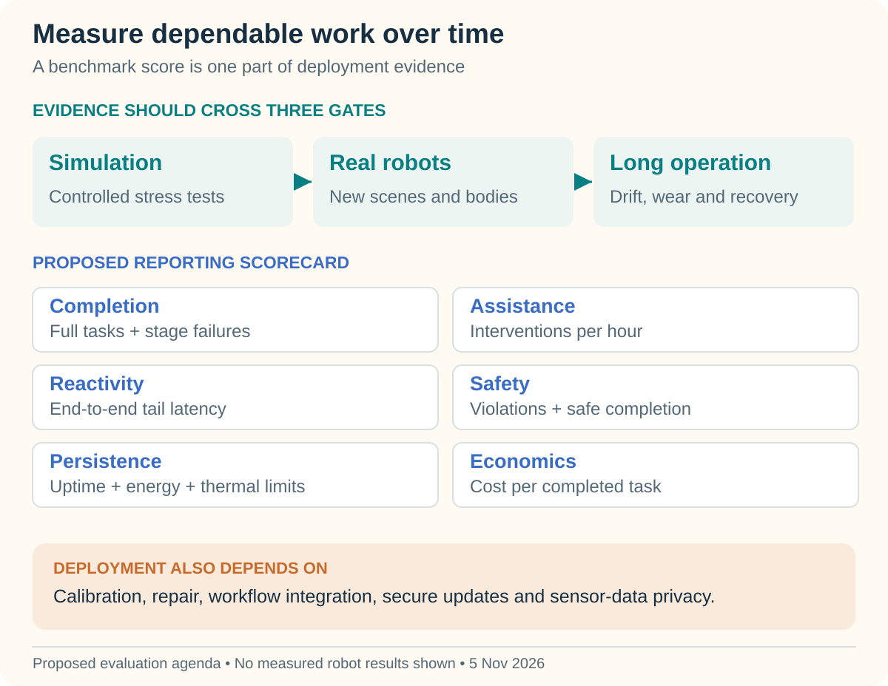

**Updated 5 November 2026.** Cross-cutting challenges for manipulation, mobile, legged and collaborative robots.

Robots are gaining broader skills. The central research challenge is making those skills **transfer, compose and remain dependable under physical uncertainty**. The twelve topics below form a synthesis, not a ranking. [Recent research overview](https://www2.eecs.berkeley.edu/Pubs/TechRpts/2026/EECS-2026-267.html).

## Generalization across tasks and robot bodies

- **Open problem:** separate transferable physical skills from memorized settings; handle several distribution shifts together.
- **2026 signal:** π0.7 reports early compositional and cross-body transfer. Its appliance experiments distinguish a single prompt, language coaching and a subsequently trained high-level policy. These conditions matter when interpreting generalization. [π0.7, 16 April](https://www.pi.website/blog/pi07).

## Data efficiency and continued learning

- **Open problem:** align heterogeneous experience, bridge simulation to reality, and learn from failures without unsafe exploration or forgetting previous skills.
- **Research directions:** targeted data collection, shared representations, synthetic experience and reinforcement learning with corrections. A world model predicts possible futures; the unresolved test is whether those predictions support reliable physical actions. [Berkeley research](https://www2.eecs.berkeley.edu/Pubs/TechRpts/2026/EECS-2026-267.html), [π0.7 data mixture](https://www.pi.website/blog/pi07), [learning from experience](https://www.pi.website/blog/pistar06).

## Perception and dexterous contact

- **Open problem:** infer hidden state through occlusion and sensor noise; coordinate contact, force and deformation rather than only object position.
- **2026 signal:** HandsOn diagnoses failures in making contact, coordinating actions and preserving achieved goals. Its benchmark is simulated; qualitative real-robot demonstrations do not establish a real-world success rate. [HandsOn, 19 October](https://arxiv.org/abs/2610.26765).

## Memory and recovery over long tasks

- **Open problem:** retain relevant history, track progress, detect failures and choose recovery actions before errors cascade.
- **2026 signal:** Multi-Scale Embodied Memory reports tasks requiring up to 15 minutes of memory. DexArena evaluates skill transitions and complete sequences alongside individual stages. [MEM, 3 March](https://www.pi.website/research/memory), [DexArena, revised 3 November](https://arxiv.org/abs/2611.02629v2).

## Real-time control and whole-body mobility

- **Open problem:** synchronize reasoning and control under latency, limited computation and changing contacts; combine navigation, reaching and balance.
- **Research directions:** asynchronous inference, consistent action chunks, local feedback and models adapted to onboard hardware. Gemini Robotics 2 reports progress in whole-body control while identifying movement speed and multifinger manipulation as remaining limitations. [Real-Time Chunking](https://www.pi.website/research/real_time_chunking), [Gemini Robotics 2, 30 July](https://deepmind.google/blog/gemini-robotics-2-brings-whole-body-intelligence-to-robots/).

## Safety and collaboration with people

- **Open problem:** connect risk recognition to feasible mitigation, calibrated uncertainty and safe fallback. Human and robot teammates also need clear intent, role allocation and predictable motion.
- **2026 signal:** ResponsibleRobotBench separates terminal safety from safe task completion. RESONATE measures navigation efficiency, safety and human comfort together in physical experiments. Model reasoning and benchmark performance alone do not provide a safety guarantee. [ResponsibleRobotBench, revised 3 November](https://arxiv.org/abs/2512.04308v2), [RESONATE, 2 November](https://arxiv.org/abs/2611.02937).

## Evaluation and persistent deployment

- **Open problem:** make experiments reproducible across hardware and measure useful work despite drift, battery limits, wear and human intervention. Hardware and software integration remain central to sustained operation. [Industrial field deployment study](https://doi.org/10.1002/rob.70198).
- **Proposed evaluation agenda:** hold out tasks, environments and robot bodies; disclose adaptation data, coaching, resets and assistance. Report repeated trials and uncertainty, then track safety, uptime, repair, energy, privacy, security and cost during longer runs. [RoboCasa365](https://arxiv.org/abs/2603.04356), [DexArena](https://arxiv.org/abs/2611.02629v2), [RESONATE](https://arxiv.org/abs/2611.02937).

## Recent research at a glance

| Date in 2026 | Primary source | What it helps investigate |
| --- | --- | --- |
| 3 Nov revision | [ResponsibleRobotBench](https://arxiv.org/abs/2512.04308v2) · preprint | Hazard recognition, executable mitigation and safe completion |
| 3 Nov revision | [DexArena](https://arxiv.org/abs/2611.02629v2) · preprint | 10 long tasks and 30 stage tasks; skill composition in simulation |
| 2 Nov | [RESONATE](https://arxiv.org/abs/2611.02937) · preprint | 320 physical experiments; efficiency, safety and social comfort |
| 19 Oct | [HandsOn](https://arxiv.org/abs/2610.26765) · preprint | 66 simulation tasks; dexterity and transfer across embodiments |
| 14 Aug | [Building Generally Intelligent Robots](https://www2.eecs.berkeley.edu/Pubs/TechRpts/2026/EECS-2026-267.html) · dissertation | Data coverage, architecture efficiency, transfer and memory |
| 30 Jul | [Gemini Robotics 2](https://deepmind.google/blog/gemini-robotics-2-brings-whole-body-intelligence-to-robots/) · developer report | Whole-body control, onboard inference and teamwork |
| 16 Apr | [π0.7](https://www.pi.website/blog/pi07) · developer report | Steerability and early compositional generalization |
| 4 Mar | [RoboCasa365](https://arxiv.org/abs/2603.04356) · ICLR 2026 | 365 simulated household tasks across 2,500 kitchen environments |
| 3 Mar | [MEM](https://www.pi.website/research/memory) · developer report | Short observation history plus longer language memory |

*Different benchmarks test different tasks, bodies and assistance conditions; their scores are not interchangeable. All eight figures are original conceptual diagrams. The probability example is illustrative; the final scorecard is a proposed research agenda.*
